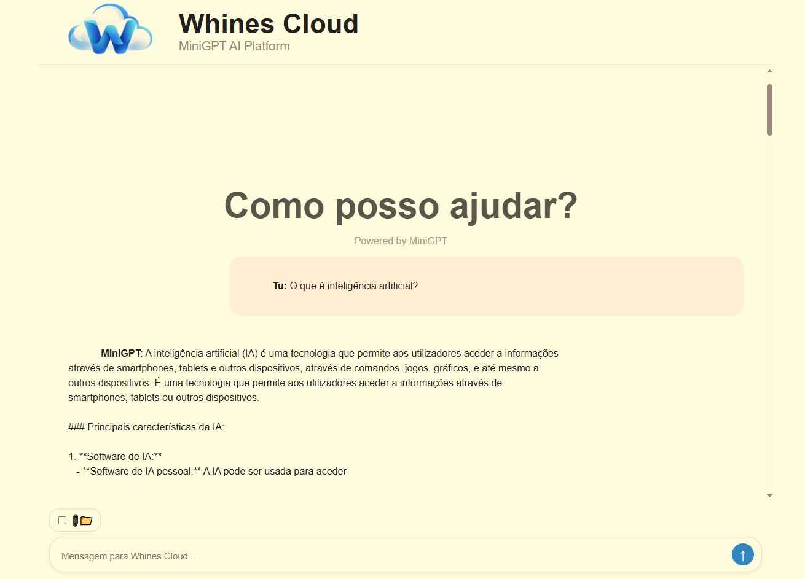
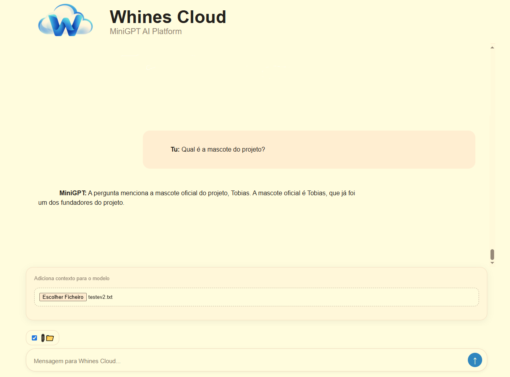
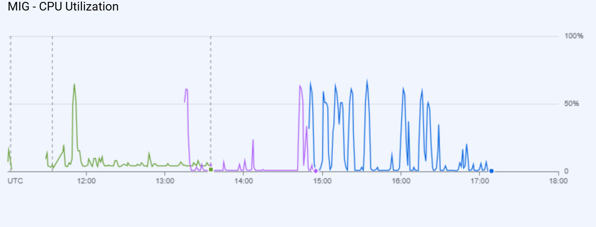
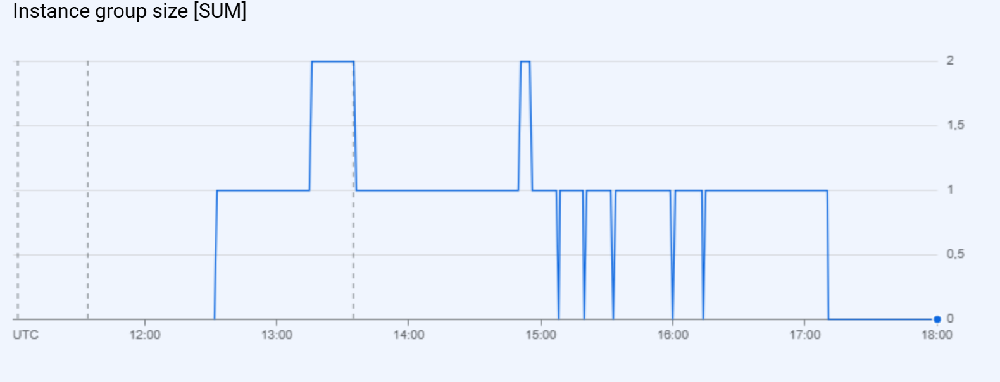
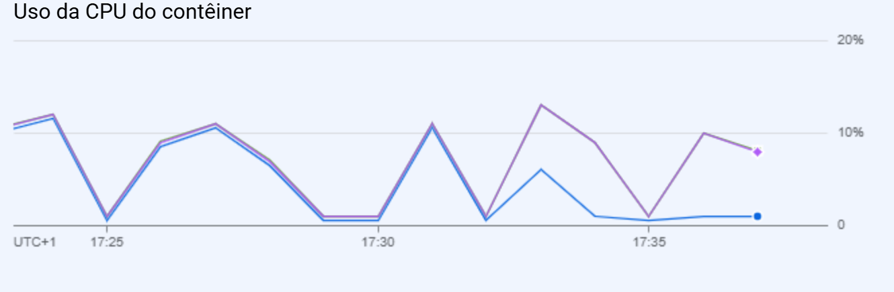
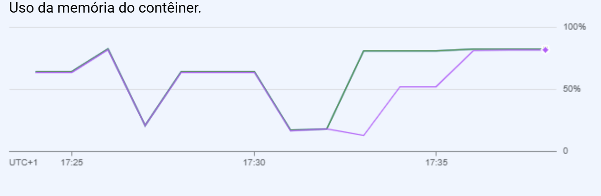
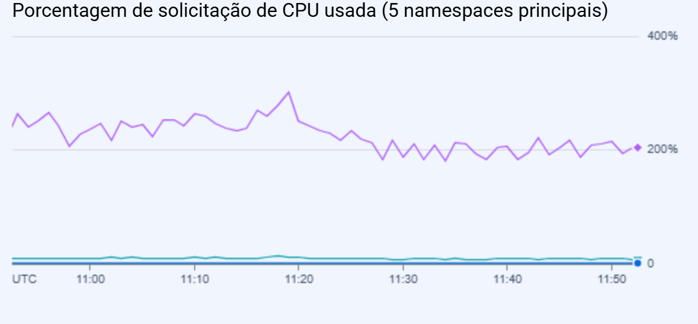
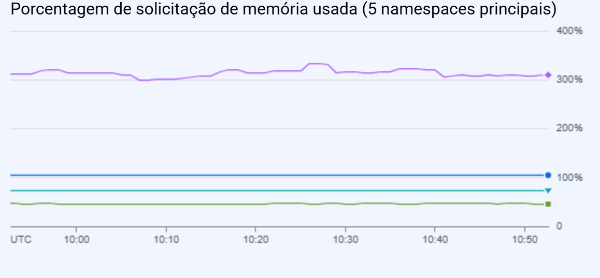

# Whines AI

### From understanding a gradient to building and deploying an LLM system

Whines AI started with a simple goal: **I wanted to understand what was actually happening inside a neural network.**

Instead of jumping directly into high-level AI APIs or wrapping an existing LLM, I decided to work from the foundations upward. I studied the mathematics behind machine learning, implemented neural networks and autograd concepts, experimented with CNNs and GPU computing and gradually moved into attention, Transformers and language models.

That learning journey eventually became **Whines AI**: an end-to-end AI engineering project centered around a custom **\~110M parameter GPT-style language model**, trained and fine-tuned on Portuguese data.

But building the model raised a new set of questions:

> How do I serve it efficiently?
> How do I give it external knowledge?
> How do I track experiments and data?
> How do I containerize it?
> What happens when multiple users hit it at once?
> How does it scale in the cloud?

Answering those questions expanded the project into inference engineering, RAG, MLOps, Docker, Google Cloud, Kubernetes, autoscaling, monitoring and load testing.

The result is not just a language model, but my attempt to understand and build the **full engineering stack around one**.

---

## Project Journey

Linear Algebra + Calculus
          ↓
Gradient Descent + Backpropagation
          ↓
Neural Networks + Autograd
          ↓
PyTorch
          ↓
CNNs + Computer Vision
          ↓
GPU / CUDA
          ↓
Attention + Transformers
          ↓
MiniGPT (~110M parameters)
          ↓
Pretraining + Supervised Fine-Tuning
          ↓
KV Cache + Continuous Batching
          ↓
Retrieval-Augmented Generation
          ↓
FastAPI + Web Interface
          ↓
MLflow + DVC + Data Validation
          ↓
Docker + Artifact Registry
          ↓
Compute Engine / Cloud Run / GKE
          ↓
Autoscaling + Monitoring + Load Testing

---

# 1. Foundations — Understanding What the Framework Does

I did not want PyTorch's `loss.backward()` to be a magic function.

Before focusing on larger models, I worked through the foundations required to understand what happens during training:

- Linear algebra for machine learning
- Calculus and derivatives
- Gradient descent and optimization
- Forward propagation
- Backpropagation
- Automatic differentiation / autograd
- Loss functions
- Neural-network architecture
- PyTorch fundamentals
- GPU computation

Several of these concepts were implemented directly under:

learning/foundations/

including neural-network and autograd experiments.

This part of the project gave me the mental model I later relied on when working with much larger PyTorch architectures.

---

# 2. Deep Learning & Computer Vision

The next step was moving from basic neural networks into deeper architectures and real training experiments.

I explored:

- Multi-layer neural networks
- PyTorch training loops
- GPU training
- CUDA fundamentals
- Batch-size experiments
- Performance profiling
- Convolutional Neural Networks
- Image classification

A cats-vs-dogs CNN experiment is preserved in:

learning/vision/cat_dog_cnn.py

This was also where hardware constraints became much more tangible: GPU memory, batch size, data loading and compute performance started becoming engineering concerns rather than abstract concepts.

---

# 3. From Neural Networks to Transformers

After building a foundation in deep learning, I moved into the architecture behind modern language models.

Topics included:

- Tokenization
- Embeddings
- Self-attention
- Causal attention
- Multi-head attention
- Feed-forward networks
- Transformer blocks
- Autoregressive generation
- Sampling and decoding
- Pretraining
- Supervised Fine-Tuning

Instead of stopping at the theory, I used these concepts to build the main model of the project: **MiniGPT**.

---

# 4. MiniGPT — \~110M Parameters

MiniGPT is a custom GPT-style autoregressive language model with approximately **110 million parameters**.

### Architecture

Vocabulary:          32,000 tokens
Embedding size:      768
Attention heads:     12
Transformer layers:  12
Context length:      1,024 tokens
Parameters:          ~110M

The architecture includes:

- Token embeddings
- Causal multi-head self-attention
- Pre-LayerNorm Transformer blocks
- Residual connections
- GELU feed-forward networks
- Weight tying between token embeddings and the language-model head
- Autoregressive token generation

Core implementation:

src/minigpt/model.py

One important goal of MiniGPT was educational: it is small enough for me to understand and experiment with the complete architecture while still being large enough to expose real problems around training, memory, inference and deployment.

---

# 5. Data & Training Pipeline

Building the model also meant building the pipeline around its data.

Portuguese text / conversations
             ↓
Processing & Curation
             ↓
Tokenizer Training
             ↓
Tokenization
             ↓
Pretraining
             ↓
Supervised Fine-Tuning
             ↓
Inference Model

The repository contains tooling for dataset building, inspection, curation and tokenization:

src/minigpt/data_processing/
src/minigpt/tokenization/
src/minigpt/pretrain/
src/minigpt/sft/

MiniGPT was pretrained using Portuguese-language data and subsequently adapted for conversational behavior through supervised fine-tuning.

---

# 6. Inference Engineering

Once MiniGPT could generate text, the next question was:

> What happens when more than one request arrives?

That led to a dedicated inference engine rather than simply calling `model.generate()` independently for every request.

Implemented concepts include:

- KV caching
- Batched inference
- Continuous batching
- Request scheduling
- Per-sequence position handling
- Attention masking
- Tensorized decoding
- Concurrent request management

Core implementation:

src/minigpt/inference_engine.py

Dedicated evaluation scripts validate individual inference components:

scripts/evaluation/test_batched_kv.py
scripts/evaluation/test_inference_engine.py
scripts/evaluation/test_kv_cache.py
scripts/evaluation/test_model_loader.py

This was one of the points where the project shifted from primarily **ML engineering** toward **ML systems engineering**.

---

# 7. Retrieval-Augmented Generation

A language model is limited by the information encoded in its parameters.

To let Whines AI work with external documents, I built a custom **Retrieval-Augmented Generation pipeline**.

Documents
    ↓
Ingestion
    ↓
Embeddings
    ↓
Vector Store
    ↓
Dense Retrieval + BM25
    ↓
Reciprocal Rank Fusion
    ↓
Cross-Encoder Reranking
    ↓
Context Construction
    ↓
MiniGPT

The implementation includes:

- Document ingestion
- Multilingual embeddings
- Vector similarity search
- BM25 lexical retrieval
- Hybrid retrieval
- Reciprocal Rank Fusion
- Cross-encoder reranking
- Context construction
- Source-aware generation

Implementation:

src/rag/

---

# 8. LLM System Architecture

The model and retrieval components are integrated through a higher-level orchestration layer.

                     User
                       ↓
                  FastAPI
                       ↓
              Router / Orchestrator
                  ↙          ↘
                RAG        Direct LLM
                  ↘          ↙
                Inference Engine
                       ↓
                    MiniGPT
                       ↓
                    Response

Relevant components:

src/llm_system/router.py
src/llm_system/orchestrator.py
src/llm_system/inference_service.py

MiniGPT is exposed through FastAPI/Uvicorn and connected to a browser-based interface, turning the model into an actual usable application rather than a training script.

### Whines AI in Action

The final application exposes MiniGPT through a browser-based interface and supports both direct language-model generation and retrieval-augmented generation using uploaded documents.

#### Direct MiniGPT Generation

  

#### Retrieval-Augmented Generation

  

The second example uses an uploaded document containing project-specific information. MiniGPT retrieves the external context and uses it to answer a question whose information is not expected to come from the model's pretrained knowledge.
---

# 9. MLOps

Training a model successfully is not the end of its lifecycle.

This part of the project explored how ML experiments, data, models and deployments can be made more reproducible and manageable.

### MLflow — Experiment & Model Tracking

MLflow tooling is used for experiment/model tracking and registration:

scripts/mlops/track_minigpt.py
scripts/mlops/register_minigpt.py
scripts/mlops/model_info.py

### DVC — Data & Pipeline Versioning

The project also uses DVC configuration to define reproducible ML pipeline stages:

dvc.yaml

### Data Validation

Dedicated validation tooling generates reports about the data and model:

scripts/mlops/validate_minigpt_data.py
reports/data_validation.json
reports/model_info.json

Together, this introduced me to the operational side of machine learning:

Data
 ↓
Versioning / Validation
 ↓
Training
 ↓
Experiment Tracking
 ↓
Model / Artifacts
 ↓
Serving
 ↓
Deployment
 ↓
Monitoring

---

# 10. Containerization & Artifact Management

The complete serving stack is packaged as a **Docker container** containing:

MiniGPT
+ Inference Engine
+ RAG
+ FastAPI
+ Application dependencies

Serving dependencies are isolated in:

requirements-serving.txt

The production image is pushed to **Google Artifact Registry**, allowing the same container to be deployed across different cloud architectures.

This became important for the next part of the project: instead of changing the application for every infrastructure experiment, I could compare different ways of running the **same workload**.

---

# 11. Cloud Engineering — Three Deployment Strategies

I deliberately deployed Whines AI in three different ways.

The goal was not simply to get a public URL. I wanted to understand what each abstraction was doing for me.

## A. Compute Engine + Managed Instance Groups

The first deployment exposed the container through more traditional VM infrastructure:

Internet
   ↓
Global Load Balancer
   ↓
Backend Service
   ↓
Managed Instance Group
   ↓
Compute Engine VM(s)
   ↓
Docker
   ↓
Whines AI

This required working directly with:

- Compute Engine
- VM templates
- Managed Instance Groups
- Health checks
- Load balancing
- VM autoscaling
- Self-healing
- Cloud monitoring

This was the deployment where I had the most direct visibility into the infrastructure.

It also produced one of the most useful failures of the project.

During a 1,000-request stress test, the workload overwhelmed the application faster than new VM capacity could become useful:

| Result   | Requests |
| -------- | -------: |
| HTTP 200 |       49 |
| HTTP 503 |      511 |
| HTTP 403 |      360 |
| Timeout  |       80 |

Total completion throughput was **1.48 req/s**, but only 49 requests completed successfully, giving an effective successful throughput of roughly **0.073 req/s**.

The experiment made an important point very concrete:

> **Autoscaling infrastructure does not automatically make an application scalable.**

VM startup time, health checks, request queues and the application's own concurrency model all matter.

### Monitoring

The MIG dashboard captured CPU utilization and changes in instance-group size during the experiments.

  
  

---

## B. Cloud Run

Next, I deployed exactly the same container using **Cloud Run**.

Internet
   ↓
Cloud Run
   ↓
Container Instance(s)
   ↓
Whines AI

Compared with the VM architecture, much of the infrastructure disappeared from my responsibility.

Cloud Run provided:

- Managed container execution
- Automatic scaling
- HTTPS
- Instance concurrency controls
- Scale-to-zero
- Managed infrastructure

A valid 100-request benchmark produced:

| Result   | Requests |
| -------- | -------: |
| HTTP 200 |       84 |
| HTTP 500 |       12 |
| HTTP 429 |        4 |

Total requests: 100
Successful:     84%
Time:           90.2 s
Throughput:     1.11 req/s
Successful throughput: ~0.93 req/s

Cloud Run also exposed another ML-specific problem: **cold starts are expensive when an instance needs to load a language model, embedding model and reranker before serving traffic.**

More aggressive stress testing also hit project CPU/memory quotas and client-side connection failures, which reinforced that serverless scaling still has physical and quota limits.

### Monitoring

The Cloud Run dashboard captured:

- Request counts
- Request latency
- Container instance count
- Container CPU
- Container memory
- Maximum concurrent requests
- Network traffic

  
  

---

## C. Kubernetes / Google Kubernetes Engine

The final deployment used **Google Kubernetes Engine (GKE)**.

GKE is Google's managed Kubernetes service, so this experiment exposed the orchestration layer directly:

GKE Cluster
│
├── Node (VM)
│   ├── Pod → Whines AI Container
│   └── Pod → Whines AI Container
│
└── Node (VM)
    ├── Pod → Whines AI Container
    └── ...

The deployment explored:

- Deployments
- Pods
- Services
- LoadBalancer Services
- CPU/memory requests
- Resource limits
- Scheduling
- Horizontal Pod Autoscaling (HPA)
- Cluster Autoscaling
- Kubernetes metrics

Manifests are stored under:

infrastructure/kubernetes/

---

# 12. Kubernetes Autoscaling Experiment

This experiment produced one of my favorite results from the project because it made the difference between **application scaling** and **infrastructure scaling** immediately visible.

### Step 1 — One Pod

With one Whines AI Pod on a single `e2-standard-2` Node:

1 Node
└── 1 Pod

1000 / 1000 requests successful
~1.10 req/s

### Step 2 — More Pods, Same Hardware

I then ran two Pods on the **same Node**:

1 Node
├── Pod 1
└── Pod 2

Result:

200 / 200 successful
1.07 req/s

Adding another Pod had not created another CPU.

The two model instances were competing for the same underlying hardware, so throughput did not improve.

### Step 3 — Scale the Infrastructure Too

I configured:

Horizontal Pod Autoscaler
1 → 5 Pods
CPU target: 60%

Cluster Autoscaler
1 → 3 Nodes

Under load, Kubernetes/GKE eventually reached:

3 Nodes
5 Whines AI Pods

The final benchmark produced:

200 / 200 successful
67.4 seconds
2.97 req/s

Compared with the 2-Pod / 1-Node test:

**1.07 req/s → 2.97 req/s (\~2.8×)**

while maintaining a **100% success rate**.

That experiment made one Kubernetes principle impossible to forget:

> **Scaling Pods does not create compute. The application and the infrastructure have to scale together.**

### GKE Monitoring

The GKE dashboard captured the behavior of the cluster during these experiments, including CPU and memory requests, container restarts, Prometheus ingestion and Kubernetes system namespaces.

  
  

---

# 13. Benchmark Summary

These benchmarks were experiments performed under different configurations and loads, so they should not be treated as a strict apples-to-apples performance competition.

Their purpose was to understand the behavior and trade-offs of each architecture.

| Architecture           | Test                       | Result                                                                           |
| ---------------------- | -------------------------- | -------------------------------------------------------------------------------- |
| Compute Engine + MIG   | 1000 requests / 20 workers | 4,9% success throughput \~0.073 req/s |
| Cloud Run              | 100 requests / 10 workers  | 84% success, \~0.93 successful req/s                                             |
| GKE — 1 Pod / 1 Node   | 1000 requests / 20 workers | **100% success, \~1.10 req/s**                                                   |
| GKE — 2 Pods / 1 Node  | 200 requests / 20 workers  | **100% success, 1.07 req/s**                                                     |
| GKE — 5 Pods / 3 Nodes | 200 requests / 20 workers  | **100% success, 2.97 req/s**                                                     |

The most meaningful controlled comparison was inside GKE:

Same load
Same application
Same container

2 Pods / 1 Node       → 1.07 req/s
5 Pods / 3 Nodes      → 2.97 req/s

---

# 14. Monitoring & Observability

One lesson from the cloud phase was that application output alone does not tell the whole story.

During the experiments I monitored:

- CPU utilization
- Memory utilization
- Request latency
- Request success/failure
- Container concurrency
- Instance counts
- Pod counts
- Node counts
- Autoscaling behavior
- Backend health
- Container restarts
- Network traffic

The monitoring screenshots in this repository are not just decorative dashboards — they helped explain why particular load tests behaved the way they did.

---

# 15. What I Learned

The biggest outcome of this project was not any single benchmark.

It was seeing concepts that initially felt unrelated become parts of the same system.

### `loss.backward()` stopped being magic

Studying derivatives, backpropagation and autograd before relying heavily on PyTorch made the framework much easier to reason about.

### Training a model is only the beginning

Once MiniGPT existed, entirely new problems appeared: inference latency, concurrency, retrieval, deployment, memory consumption, cold starts, monitoring and scaling.

### More replicas ≠ more compute

The Kubernetes experiment demonstrated this particularly clearly. Two Pods competing for one Node were no faster than one. Scaling the Nodes changed the result.

### Autoscaling is reactive, not magical

The MIG experiments showed that an autoscaler cannot save a system instantly. New capacity takes time to become useful and the application still needs appropriate admission control, queueing and health behavior.

### ML workloads make cold starts expensive

Starting Whines AI means loading much more than a normal web server. Model architecture and infrastructure architecture cannot be considered independently.

### Failure was often more educational than success

Some of the most useful parts of this project came from things breaking: GPU constraints, memory limits, unhealthy backends, Cloud Run quotas, container startup times and overloaded inference.

Those failures forced me to understand what each layer was actually doing.

---

# 16. Technology Stack

### Mathematics & ML

- Linear Algebra
- Calculus
- Gradient Descent
- Backpropagation
- Autograd
- Python
- NumPy
- PyTorch
- CUDA
- CNNs

### LLM Engineering

- Transformer architecture
- Custom GPT-style model
- Tokenization
- Pretraining
- Supervised Fine-Tuning
- KV Cache
- Continuous Batching
- Request Scheduling
- RAG
- Sentence Transformers
- BM25
- Reciprocal Rank Fusion
- Cross-Encoder Reranking

### Backend

- FastAPI
- Uvicorn

### MLOps

- MLflow
- DVC
- Data validation
- Model tracking / registration
- Docker
- Load & stress testing
- Monitoring

### Google Cloud

- Artifact Registry
- Compute Engine
- Managed Instance Groups
- Global Load Balancing
- Cloud Run
- Google Kubernetes Engine
- Kubernetes HPA
- Cluster Autoscaler
- Cloud Monitoring

---

# 17. Repository Structure

learning/
├── foundations/       # Autograd, neural networks and PyTorch fundamentals
├── vision/            # CNN experiments
└── legacy/            # Earlier LLM experiments

src/
├── minigpt/
│   ├── data_processing/
│   ├── pretrain/
│   ├── sft/
│   └── tokenization/
├── rag/
└── llm_system/

scripts/
├── benchmarks/
├── evaluation/
├── exploration/
├── mlops/
└── utilities/

infrastructure/
└── kubernetes/

reports/
├── data_validation.json
└── model_info.json

dvc.yaml
requirements-serving.txt

---

# 18. Future Improvements

There are several things I would change or explore next if continuing the system:

- Separate RAG and model-serving workloads
- Avoid loading retrieval models when RAG is disabled
- GPU-backed cloud inference
- Queue-based asynchronous generation
- Request/queue-depth based autoscaling
- Larger and higher-quality training datasets
- Better model evaluation
- Automated CI/CD
- More comprehensive production observability
- Infrastructure as Code
- Distributed inference

---

# Final Perspective

I started this project because I wanted to understand how neural networks actually worked.

At first that meant understanding a derivative, a gradient, a weight update and backpropagation.

Eventually it meant understanding why five Kubernetes Pods on one machine do not magically give you five machines.

Somewhere between those two questions, I built and trained a \~110M parameter language model, implemented an inference engine and RAG system, tracked ML experiments, containerized the application, deployed it through three different cloud architectures, broke those architectures under load and learned how to make them scale.

There are much larger and much better language models than MiniGPT.

That was never really the point.

**The point was to understand what happens between the math and the production system — by building as much of that path as I could myself.**
